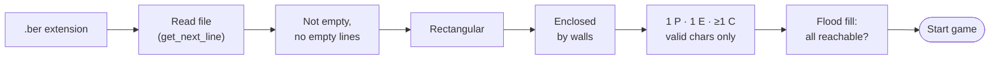

<h1 align="center">🦖 so_long</h1>

<p align="center">
  <b>A 2D maze game written in C with the MiniLibX graphics library.</b><br>
  Guide DINO through the maze, eat every chocolate, then rush him to the hospital.
</p>

<p align="center">
  
  
  
  
  
</p>

---

## 📑 Table of Contents

- [About](#-about)
- [Features](#-features)
- [Requirements](#-requirements)
- [Installation](#-installation)
- [Usage](#-usage)
- [Controls](#-controls)
- [Maps](#-maps)
- [How It Works](#-how-it-works)
- [Error Handling](#-error-handling)
- [Project Structure](#-project-structure)
- [Author](#-author)

---

## 📖 About

**so_long** is a 2D maze game where the player navigates through a maze, collects items, and reaches the exit. Before the game starts, a **backtracking** algorithm checks that the map can actually be won. Graphics are rendered with the **MiniLibX** library.

The player controls **DINO**, a hungry dinosaur loose in a maze full of chocolates. The hospital exit stays locked until DINO has eaten every chocolate. Once he has, he feels sick, the exit opens, and you have to get him there.

The game is part of the **42 Common Core** curriculum. It covers:

- event-driven programming with a window, a key-hook loop and sprite rendering
- parsing and validating an input file
- graph traversal (flood fill with recursive backtracking) to check that a level can be solved
- manual memory management with no leaks

---

## ✨ Features

- 🗺️ **Custom maps:** load any level from a plain-text `.ber` file
- 🔍 **Map validation:** the game checks the shape, the walls, the tile characters and whether every item can be reached before it opens a window
- 🧠 **Backtracking path check:** a recursive flood fill confirms that every chocolate and the exit can be reached from the start
- 🎮 **Keyboard controls:** WASD or the arrow keys
- 🚪 **Locked exit:** the exit only opens after every collectible is eaten
- 🤒 **Change of state:** DINO's sprite and the on-screen message change once the last chocolate is eaten
- 📊 **Live HUD:** the move and chocolate counters are drawn in the window and the move count is also printed to the terminal
- 🧹 **Clean shutdown:** every image, window and map buffer is freed on exit (checked with Valgrind)

---

## 🛠 Requirements

- **Linux** with an X11 server (also tested on **WSL2 with WSLg**)
- `clang`, `make`
- X11 / Xext development headers
- `libbsd` (used by the MiniLibX build)

On Debian / Ubuntu:

```bash
sudo apt-get update
sudo apt-get install clang make xorg libx11-dev libxext-dev libbsd-dev
```

---

## 📦 Installation

```bash
git clone https://github.com/rasiolisufaj/42-so_long.git
cd 42-so_long
make
```

`make` builds `libft`, then MiniLibX, then the `so_long` binary.

| Command       | Description                                      |
| ------------- | ------------------------------------------------ |
| `make`        | Build libft, MiniLibX and `so_long`              |
| `make clean`  | Remove object files                              |
| `make fclean` | Remove object files, `libft.a` and the binary    |
| `make re`     | Rebuild everything from scratch                  |

---

## 🚀 Usage

```bash
./so_long <path/to/map.ber>
```

Example:

```bash
./so_long maps/labyrinth.ber
```

> [!NOTE]
> Run the game from the repository root. Textures are loaded from the relative path `textures/`.

When DINO reaches the open exit, the game ends with a summary:

```text
Well Done!
DINO ate 4 chocolates in 13 moves!
```

---

## 🎮 Controls

| Key                 | Action          |
| ------------------- | --------------- |
| `W` / `↑`           | Move up         |
| `A` / `←`           | Move left       |
| `S` / `↓`           | Move down       |
| `D` / `→`           | Move right      |
| `ESC`               | Quit the game   |
| Window close button | Quit the game   |

Moving into a wall or into the locked exit does not count as a move.

---

## 🗺 Maps

A map is a plain-text file with the `.ber` extension, built from these characters:

| Char | Meaning                   | Sprite                       |
| :--: | ------------------------- | ---------------------------- |
| `1`  | Wall                      | brick wall                   |
| `0`  | Empty floor               | grass                        |
| `P`  | Player start position     | DINO                         |
| `C`  | Collectible               | chocolate                    |
| `E`  | Exit                      | hospital (locked or open)    |

### Rules

A map is valid only if **all** of these are true:

- the file name ends in `.ber`
- the map is **rectangular** (every row has the same length)
- the map is **enclosed by walls** (`1`) on all four sides
- it contains **exactly one** `P`, **exactly one** `E` and **at least one** `C`
- it contains **no other characters** and **no empty lines**
- every `C` and the `E` can be **reached** from `P`

### Example

```text
1111111111
1P0C100C01
10C000E0C1
1111111111
```

### Included maps

| Map                  | Size    |
| -------------------- | ------- |
| `maps/map.ber`       | 10 × 4  |
| `maps/labyrinth.ber` | 20 × 12 |
| `maps/long_map.ber`  | 20 × 12 |

Each tile is **80 × 80 px**, so the window is `columns × 80` pixels wide and `rows × 80` pixels tall.

---

## ⚙ How It Works

### 1. Validation

The map is fully checked before a window opens. The first check that fails stops the program with an error message.



### 2. Backtracking path check

`flood_fill.c` runs a **recursive depth-first search** from the player's start position:

1. It marks each visited cell on a duplicate grid so no cell is explored twice.
2. Walls (`1`) block the search. The exit (`E`) is recorded as reached but is never walked through, because in the game the player can't pass through it.
3. When it finds a chocolate, it marks the cell and increments a counter.
4. It tries the four directions in turn (left, up, right, down). When a branch hits a dead end, it **backtracks** to the last cell that still has unexplored neighbours.
5. It returns **as soon as** the exit has been seen and the number of chocolates found equals the total on the map.

If the search finishes without meeting that condition, the map can't be won and is rejected with `Invalid pathing!`.

### 3. Game loop

- **MiniLibX** opens a window and loads the seven XPM sprites.
- A **key-press hook** moves DINO by one tile, updates the map grid, redraws the scene and refreshes the HUD.
- A **destroy hook** handles the window's close button.
- When the last chocolate is eaten, the exit sprite changes to *open* and DINO changes to his *sick* sprite.
- Stepping onto the open exit ends the game, prints the final score and frees all resources.

---

## 🚨 Error Handling

Every error prints `ERROR` followed by a message, then the program exits with status `1` and frees everything it had allocated.

| Message                                   | Cause                                                       |
| ----------------------------------------- | ----------------------------------------------------------- |
| `Invalid number of arguments!`            | The program was not given exactly one map path              |
| `Invalid map extension!`                  | The file name does not end in `.ber`                        |
| `Can't read the map!`                     | The file does not exist or cannot be opened                 |
| `'<file>' is a directory!`                | The path points to a directory                              |
| `Map is empty!`                           | The file is empty                                           |
| `Map contains an empty line!`             | The map has a blank line                                    |
| `The map is not rectangular!`             | The rows have different lengths                             |
| `Open map on line nX and column nY!`      | A border tile is not a wall                                 |
| `Invalid map contents!`                   | Wrong `P`/`E`/`C` counts or an unknown character            |
| `Invalid pathing!`                        | A chocolate or the exit cannot be reached                   |
| `MLX is not initiated!`                   | MiniLibX could not connect to the X server                  |
| `The window is not initiated!`            | The window could not be created                             |
| `Image_<name> does not exist!`            | A texture file is missing or invalid                        |

---

## 📁 Project Structure

```text
42-so_long/
├── Makefile
├── includes/
│   └── so_long.h          # structs, key codes, prototypes
├── srcs/
│   ├── main.c             # entry point, window and hooks
│   ├── maps.c             # map reading and tile rendering
│   ├── check_maps.c       # rectangle, wall and content checks
│   ├── check_maps_2.c     # extension, empty-line and path checks
│   ├── flood_fill.c       # backtracking path validation
│   ├── movement.c         # key handling and player movement
│   ├── images.c           # texture loading
│   ├── text.c             # on-screen HUD text
│   ├── exit.c             # win / quit handling
│   ├── free.c             # resource cleanup
│   └── check_errors.c     # MiniLibX init checks
├── libft/                 # custom C library (incl. ft_printf, get_next_line)
├── minilbx/               # MiniLibX for Linux
├── maps/                  # sample .ber maps
└── textures/              # 80×80 XPM sprites
```

---

## 👤 Author

**rasiolisufaj** · 42 login `raisufaj`

[](https://github.com/rasiolisufaj)

<p align="center"><sub>Made at 42 🦖🍫</sub></p>
